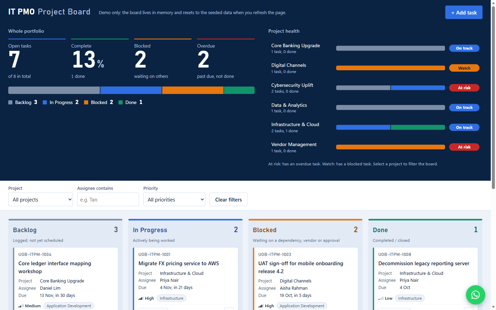

# IT PMO Kanban Board

A single-file Kanban board demo for an IT Project Management Office, built with plain HTML, CSS and JavaScript — no frameworks, no build step, no dependencies.

**Live demo:** https://aarondsprojects.github.io/kanban6/



> Demo only: the bank is fictitious and the board lives in memory. It resets to the seeded data whenever you refresh the page.

## Features

- **Portfolio overview:** large KPIs (open tasks, % complete, blocked, overdue) and a status bar showing the whole portfolio split by status.
- **Project health:** one status bar per project, labelled *At risk* (has an overdue task), *Watch* (has a blocked task), *On track* or *Complete*. Select a project to filter the board.
- **Colour-coded statuses:** Backlog (steel), In Progress (blue), Blocked (orange), Done (green); overdue cards are outlined in red.
- **Four columns:** Backlog, In Progress, Blocked, Done, each with a live task count.
- **Drag and drop** cards between columns, with a keyboard-accessible **Move to…** dropdown on every card as a fallback.
- **Add Task modal** with inline validation (title, assignee and due date required; Esc closes it).
- **Filters** by project, assignee and priority, plus a one-click *Clear filters*.
- **Overdue badge** on any task past its due date that isn't Done (seed dates are computed relative to today, so the demo always has overdue examples).
- **Inline delete confirmation:** no browser pop-ups.
- **Optional email notification** for new tasks via [FormSubmit](https://formsubmit.co/).
- **WhatsApp IT support widget:** a floating button (bottom right) opens a list of common IT support queries (password reset, VPN/Wi-Fi, email, printer, software, phishing, access requests, slow laptop). Picking one opens a WhatsApp chat in a new tab with the message pre-filled.
- **Security briefing reminder:** a one-time dialog after 10 seconds on the page announces the next company security briefing; it stops appearing after the briefing date.

## Run locally

No install needed. Clone the repo and open `index.html` in any modern browser:

```bash
git clone https://github.com/aaronDSProjects/kanban6.git
```

## Configuration

New-task notifications are sent through FormSubmit's AJAX endpoint. To enable them, edit the constant near the top of the `<script>` in `index.html`:

```js
const FORMSUBMIT_ENDPOINT = "https://formsubmit.co/ajax/YOUR_EMAIL@example.com";
```

FormSubmit sends a one-time activation email the first time it is used. While the placeholder address is in place, no request is sent. If the call fails or times out (10 s), the board shows a warning toast and keeps working. At most one notification is sent every 10 seconds.

> ⚠️ Anything you put in this constant is public once pushed to GitHub or served on GitHub Pages.

The WhatsApp support number and the suggested queries are set by `WHATSAPP_NUMBER` and `SUPPORT_QUERIES` in the same script (re-pin the CSP hashes afterwards, see below). The widget only builds `wa.me` links; the page itself sends nothing to WhatsApp.

## Tech and design constraints

- Vanilla HTML/CSS/JS in one file: no CDNs, web fonts or image files (icons are Unicode/inline SVG).
- No persistence: no localStorage, sessionStorage, IndexedDB or cookies.
- The only network call is the FormSubmit endpoint.
- All user input is HTML-escaped before rendering; notifications use `textContent`.

## Security

- A Content Security Policy allows only the page's own inline style and script (pinned by SHA-256 hash) and only connects to `https://formsubmit.co`. After editing the inline `<style>` or `<script>`, re-pin the hashes or the page will not load:

  ```bash
  node scripts/csp-hash.js index.html
  ```
- Typed text is stripped of control and bidi-override characters; dropdown values and dates are checked against allowed values.
- No referrer is sent, the Add task dialog traps focus, and a honeypot field filters bot submissions.

## Deployment

The site is deployed to GitHub Pages by [`.github/workflows/pages.yml`](.github/workflows/pages.yml) on every push to `main`. Only `index.html` is published.
